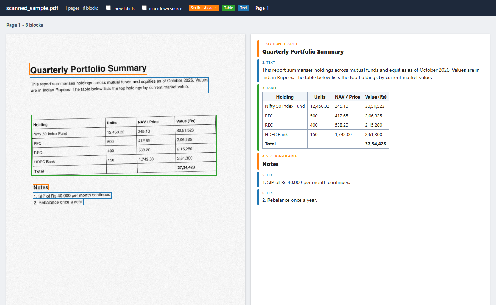

# Parse

The best OCR for everyone. Own your own intelligence.

Parse turns PDFs and scans into clean markdown, with a box around every heading, paragraph and table. It runs the best open document model available, which today is [NVIDIA Nemotron 3.5 Parse](https://huggingface.co/nvidia/Nemotron-3.5-Parse), on a GPU in your own Modal account or your own machine (Docker), so your documents stay with you and you pay for GPU time, not per page.

It is for developers who feed documents to search, RAG or LLM pipelines and want state-of-the-art parsing without a per-page vendor bill. It is also for **Chunkr users**: Chunkr's hosted API shuts down on November 15, 2026, and Parse serves the same API, so your Chunkr code keeps working. See [Migrate from Chunkr](docs/migrate-from-chunkr.md).



*A skewed, noisy scan with no text layer (left) and what Parse returns (right): the title, paragraphs and the full table, each linked to its box on the page.*

## Four ways to run it

| | Command | When to use | Measured |
|---|---|---|---|
| **Chunkr-compatible API** on your Modal account (H100) | `deltaparse deploy` | Apps that call an API; Chunkr users | first call about 2.5 min (cold start), then 8 s for a one-page scan; scales to zero when idle |
| **Chunkr-compatible API** on your own GPU (Docker, H100) | `docker run --gpus all ...` | Your own cloud or data center | ready about 2 min after start, then 2 s for a one-page task ([docs/docker.md](docs/docker.md)) |
| **Batch** on your own GPU (Modal + vLLM, H100) | `deltaparse gpu` | Bulk runs, private documents | 12.2 pages/s, about $0.15-0.35 per 1,000 pages, about 2.5 min startup |
| **Hosted** (OpenDocRouter) | `deltaparse odr` | No GPU account, small jobs | 208 pages in 109 s, $1.09 per 1,000 pages, 0 failures |

The batch and hosted commands write three files per PDF:
- `<name>.md`: the markdown for the whole document.
- `<name>.json`: every page and block, with boxes.
- `<name>.html`: the side-by-side viewer shown above.

## Quick start

```bash
git clone https://github.com/DeltaXY-AI/parse.git
cd parse
python -m venv .venv
.venv\Scripts\activate          # Windows; on macOS/Linux: source .venv/bin/activate
pip install -e ".[gpu]"
modal setup                       # log in to Modal, once

deltaparse gpu examples/sample.pdf     # writes out_vllm/sample.md, .json and .html
```

Open `out_vllm/sample.html` in a browser to see the result. `examples/scanned_sample.pdf` is the same page as a scan.

## The Chunkr-compatible API

```bash
modal secret create deltaparse-api-key DELTAPARSE_API_KEY=<a long random string>
deltaparse deploy                 # prints https://<your-workspace>--deltaparse.us-east.modal.run
```

To host it for other people, give each customer their own key. Each customer sees only their own tasks, and you can add or revoke keys without redeploying:

```bash
deltaparse keys add acme          # prints a new key for "acme", shown once
deltaparse keys list
deltaparse keys revoke acme
deltaparse usage                  # tasks and pages parsed per customer
```

All customers share one deployment: the same URL, GPU and task store. Their keys keep their tasks apart. A customer who needs their own GPU and storage can deploy Parse on their own Modal account with `deltaparse deploy`.

To delete tasks automatically, add `DELTAPARSE_DEFAULT_EXPIRES_IN=<seconds>` to the `deltaparse-api-key` secret. A request can still set its own `expires_in`, and an hourly job removes expired tasks.

To run it on your own GPU instead of Modal, build the Docker image:

```bash
docker build -t deltaparse .
docker run -d --gpus all -p 8000:8000 -e DELTAPARSE_API_KEY=<key> -v deltaparse-data:/data deltaparse
```

It needs a Hopper GPU (H100 or H200). [docs/docker.md](docs/docker.md) covers requirements, settings and how it differs from the Modal deployment.

It serves both generations of Chunkr's Python client (`chunkr-ai` 0.3.x and 0.1.0aN). Point either one at the printed URL with your key, and your code does not change. The [migration guide](docs/migrate-from-chunkr.md) covers setup, the field mapping and the known gaps. [docs/chunkr_api_reference.md](docs/chunkr_api_reference.md) records Chunkr's API as it was before the shutdown.

## All commands

```bash
deltaparse gpu    "<pdf or folder>" [--out-dir out_vllm] [--mode single|double|triple] [--limit N]
deltaparse odr    "<pdf or folder>" [--out-dir out_odr] [--model nvidia/nemotron-3.5-parse]   # needs OPEN_DOC_ROUTER_API_KEY
deltaparse deploy                                       # the Chunkr-compatible API on Modal
deltaparse serve  [--port 8000]                         # the same API on this machine's GPU (what Docker runs)
deltaparse view   out_vllm/doc.json path/to/doc.pdf     # rebuild a viewer from saved JSON
deltaparse sample [sample.pdf]                          # write a one-page test PDF
```

Run `deltaparse <command> -h` for details. `odr` reads `OPEN_DOC_ROUTER_API_KEY` from the environment or from a `.env` file in the current folder.

## Layout

```
src/deltaparse/
  cli.py       the `deltaparse` command
  gpu.py       batch backend: Modal + vLLM on an H100, blank-page skipping, fail-fast startup
  api.py       Modal deployment of the Chunkr-compatible API
  selfhost.py  the same API without Modal (Docker): task files, thread runner, readiness
  engine.py    start vLLM and parse PDFs on one GPU (shared by Modal and Docker)
  server.py    the API itself (FastAPI): Chunkr's task routes, auth, file input
  keys.py      per-customer API keys and usage for a hosted deployment
  chunkr.py    Nemotron blocks -> Chunkr segments and chunks
  odr.py       hosted backend (OpenDocRouter)
  pdf.py       find PDFs, render pages, detect blank pages
  output.py    write <name>.md, .json and .html
  viewer.py    the side-by-side HTML viewer
  sample.py    make the sample PDF
tests/         pytest suite: no network, GPU or API key needed
examples/      sample.pdf, scanned_sample.pdf, a Chunkr client check, a Docker image check
docs/          Chunkr migration guide, Docker guide and API reference
Dockerfile     the Chunkr-compatible API on any Hopper GPU
```

## Tests

```bash
pip install -e ".[dev]"
pytest
```

To also run Chunkr's own client against a local server, install it first (`pip install "chunkr-ai==0.1.0a15"`, or `"chunkr-ai==0.3.7"` on Python 3.12 or 3.13).

## Status

Early and pre-1.0. Expect breaking changes. Bugs and requests go in [GitHub Issues](https://github.com/DeltaXY-AI/parse/issues).

## License

Parse's code is licensed under the [Apache License 2.0](LICENSE). Models have their own licenses: Nemotron 3.5 Parse is under OpenMDW-1.1. See [NOTICE](NOTICE). To contribute, see [CONTRIBUTING.md](CONTRIBUTING.md).
